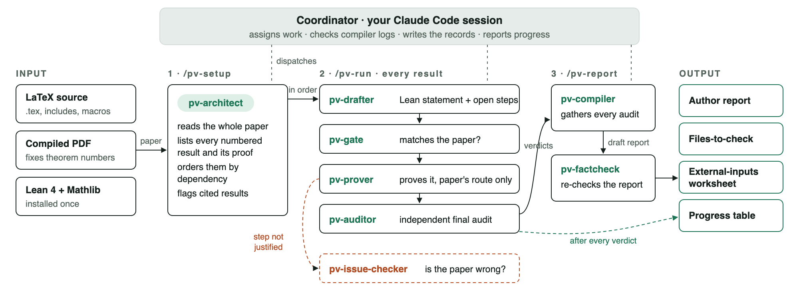
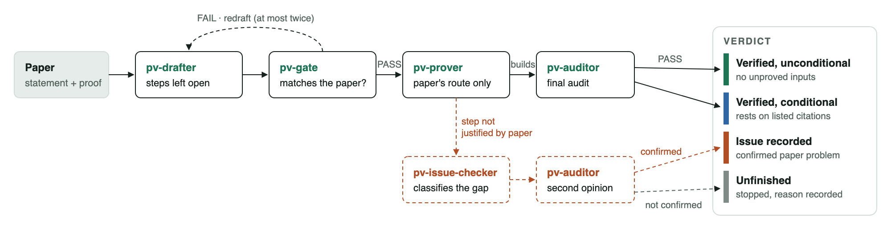

# TeX Proof-Check Kit

**Check the proofs already written in a LaTeX paper by translating them faithfully into Lean 4**, with a team of [Claude Code](https://code.claude.com/docs) agents that review each other's work. Every numbered result (theorem, proposition, lemma, corollary) gets one of four verdicts:

| Verdict | Meaning |
|---|---|
| **Verified unconditionally** | The paper's own proof compiles in Lean, with no unproved input |
| **Verified conditionally** | It compiles, but relies on results the paper cites or does not prove. These are explicit, named Lean hypotheses that a person should check |
| **Issue recorded** | A confirmed problem, located in the paper and classified by whose fault it is: false statement (`ERROR`), a justification that fails, a missing hypothesis, an uncovered case, an ambiguous domain |
| **Unfinished** | Stopped, with the reason recorded. **Never counted as an error in the paper** |

> **Scope of this version.** The kit **verifies proofs that are already written**. It checks the argument the authors wrote, step by step, and reports exactly where it holds and where it fails. It does **not** repair proofs, search for different proofs, or edit the paper. When it finds a problem, it records the evidence and the minimal change that would remove it; when the authors revise the paper, it re-checks the changed results. A mode that also proposes and verifies corrections is planned; see the [Roadmap](#roadmap).

---

## Example

[`examples/full-workflow`](examples/full-workflow/) is a two-page note with three results, taken through the whole workflow: a first check, a corrected version of the paper, a condition checked by a person, and the final report. Real output of one run:

| Result | First check | After the authors' revision and a person's check |
|---|---|---|
| Lemma 2.1: $ab \le \frac{a^2+b^2}{2}$ | **Verified unconditionally** | unchanged (not re-checked: the lemma did not change) |
| Proposition 2.2: a refinement of Nesbitt's inequality | **Verified conditionally**: relies on the cited Nesbitt inequality, an explicit Lean hypothesis | **Verified conditionally; conditions checked by a person**. A person's check is recorded, but only a Lean proof would make it unconditional |
| Lemma 2.3: $\frac{x^2}{1+x} \ge x-1$ for $x \neq -1$ | **Issue recorded (`ERROR`)**: false for $x < -1$; Lean counterexample at $x=-2$, independently reviewed | The authors changed the hypothesis to $x > -1$. Only this lemma was reset (**unfinished** until re-checked), then **verified unconditionally**; the issue is marked resolved |

```lean
-- Lemma 2.3 as first printed, and its machine-checked refutation
def PrintedClause : Prop := ∀ x : ℝ, x ≠ -1 → x ^ 2 / (1 + x) ≥ x - 1

theorem counterexample : ¬ PrintedClause := by
  intro h
  have h2 := h (-2) witness_satisfies_printed_hypothesis
  norm_num at h2

-- Proposition 2.2: the cited result is a named hypothesis, never a hidden axiom
theorem P01_main (hN : NesbittInequality) (x y z : ℝ)
    (hx : 0 < x) (hy : 0 < y) (hz : 0 < z) : P01Conclusion x y z
```

The four steps took 57, 17, under 1, and 20 minutes ($34 in total at list price). The progress table at each stage is in [TIMELINE.md](examples/full-workflow/TIMELINE.md). Both reports (before and after the revision), the Lean files and every audit are in the [example folder](examples/full-workflow/).

A shorter example, [`examples/two-lemmas-demo`](examples/two-lemmas-demo/), has one lemma that is verified and one with a planted error. It takes about 22 minutes, and is the one to run first.

## How it works



Each result goes through separate agents, and none of them reviews its own work:



- **Statements are checked before proofs.** A *gate* agent compares the Lean statement with the paper (hypotheses, quantifiers, domains, constants) before any proving starts. Its fingerprint of the statement is checked again at the end, so the statement cannot drift.
- **Only the paper's route.** The *prover* follows the paper step by step. Where the paper gives no valid justification, it stops; it does not invent a fix.
- **Independent final audit.** The *auditor* recompiles everything privately, and checks that the statement is unchanged, that only the three standard axioms are used, and that there is no `sorry` anywhere. It also checks which hypotheses each theorem really uses, and whether each step follows the paper.
- **Problems are double-checked.** A suspected error goes to an *issue-checker*, which builds a Lean counterexample when it can; a second auditor reviews the ruling. A compile failure alone never counts as an error in the paper.
- **Cited results stay visible.** What the paper cites or assumes without proof becomes an explicit `def … : Prop` hypothesis, listed for a person to check, never a hidden axiom.
- **The report is fact-checked.** An independent agent checks the final report against the records before you see it.

Records are plain files (`RESULTS.json`, Markdown reports, Lean files), so work survives usage limits and closed windows (`/pv-resume`).

## What you need

- macOS or Linux, with `git` and `python3` (3.6 or newer);
- [Claude Code](https://code.claude.com/docs), in the Claude desktop app, the VS Code extension or the terminal, on a plan that includes it;
- about 10 GB of disk space for Lean 4.19.0 and Mathlib (installed once, with internet access);
- [elan](https://github.com/leanprover/elan), Lean's installer. The guided setup can install it for you.

## Quick start (guided)

1. Make a folder for your checks and put the kit in it:

   ```bash
   mkdir -p ~/proofcheck && cd ~/proofcheck
   git clone https://github.com/ziwaa-se/tex-proof-check-kit.git
   ```

   (Or download a ZIP: **Code → Download ZIP** on this page, or **Source code (zip)** under the latest [release](https://github.com/ziwaa-se/tex-proof-check-kit/releases/latest). Unzip it in `~/proofcheck` and rename the unzipped folder (`tex-proof-check-kit-main` or `tex-proof-check-kit-1.3`) to `tex-proof-check-kit`, so that the sentence in step 2 works as written.)
2. Open `~/proofcheck` in the Claude desktop app or in VS Code, start a **new** Claude chat, and send:

   ```
   Read tex-proof-check-kit/CLAUDE_START_HERE.md and follow it.
   ```

3. Answer its questions. Claude checks your machine, installs Lean and Mathlib once (it asks before downloading anything), and makes a new folder for your paper (`papers/<name>-check/`). It then helps you put the paper's files in (`.tex`, inputs, the PDF and the `.aux`) and tells you how to start the check. That last step happens in a new chat opened **in the paper's folder**, where the kit's agents live.

To try it on the example first, add: *"I want to run the demo paper: call it demo. The files are in tex-proof-check-kit/examples/two-lemmas-demo/paper."*

Prefer to do it by hand? See [docs/QUICKSTART.md](docs/QUICKSTART.md).

## Everyday use

Always start the same way: open `~/proofcheck`, start a new chat, send the sentence above, and add what you want:

| You want to | Add |
|---|---|
| Check a new paper | "I have a new paper; call it `<name>`." |
| Continue after a usage limit or a closed window | "Continue `<name>`." (or `/pv-resume` in the paper's chat) |
| Re-check a corrected version | "My paper `<name>` has a revised version." Only the changed results, and those depending on them, are re-checked; earlier issues are marked resolved only by a new audit. |
| Record that you checked a cited result yourself | "For `<name>`, I checked `<condition>` against `<source>`." The result stays *conditional*, now marked "conditions checked by a person". |
| Get the report | "Make the report for `<name>`." |

In the paper's own chat: `/pv-status` shows the progress table. `/pv-resume` continues after any interruption. `/clear` followed by `/pv-resume` keeps long runs cheap.

The full workflow, with tested prompt templates and a section on **VS Code connected to a cluster**, is in [docs/GUIDE_EN.md](docs/GUIDE_EN.md). A one-page summary is [docs/CHEATSHEET.md](docs/CHEATSHEET.md).

## What you get

In `papers/<name>-check/verification/report/`:

| File | Content |
|---|---|
| `AUTHOR_REPORT.md` | Summary table, each verdict, the issues for the authors with exact locations, typos, and what a person still has to check |
| `FILES_TO_CHECK.md` | For each result: paper location ↔ Lean theorem (file:line) ↔ audit report |
| `EXTERNAL_TOOLS_WORKSHEET.md` | Every cited or unproved input, with its exact Lean text, sorted by risk, with check boxes |

**What only a person can do:**
1. check that the cited results are true;
2. check that the basic definitions match the paper;
3. check that each Lean statement says what the paper says.

The Lean proofs themselves need no reading: the Lean kernel checked them.

## Cost and speed

Runs use your Claude Code plan; the numbers below are list-price estimates.

| Paper | Time | Cost |
|---|---:|---:|
| Two-lemma example, both verdicts | ≈ 22 min | ≈ $9 |
| Full-workflow example: first check, revision, human check, report | ≈ 95 min | ≈ $34 |
| Three-result benchmark, three verdicts (v1.3, two runs) | 30–51 min | $14–18 |
| The same benchmark with the previous version, v1.2.1 | 83–84 min | $65–71 |

A research paper costs far more, and usage limits will pause long runs; `/pv-resume` continues them. Every result needs several independent agents even when it is easy, so a fixed cost per result is part of the design. See [bench/results/COMPARISON.md](bench/results/COMPARISON.md) for how v1.3 cut the cost by about 77% without changing a verdict.

## Limitations

- **Conditional means conditional.** A "verified conditionally" result is only as sound as its listed hypotheses. A person's check of a hypothesis is recorded, but it does not make the result unconditional.
- **Statement fidelity is reviewed by agents, not proved.** The gate and the auditor compare the Lean statement with the paper, but a person should still read the Lean statements listed in `FILES_TO_CHECK.md`.
- **Pinned versions.** Lean 4.19.0 and Mathlib `c44e0c8e`. Newer versions should work but are untested.
- **Platforms.** Developed and tested on macOS; also used on a Linux cluster through VS Code Remote-SSH.
- **No network during checks.** Agents may not browse or download, so cited works are never fetched. They are listed for a person to check.
- **AI agents run commands.** The kit runs Claude Code agents that compile and edit files in the project folder. The optional permission file (`.claude/settings.example.json`) allows only the kit's own commands and forbids network access and edits to the paper. Review it before enabling it.

## Repository layout

```
tex-proof-check-kit/
├── CLAUDE_START_HERE.md      guided setup: what a new Claude chat follows
├── autosetup/                scripts for the guided setup (environment check, shared Lean, new project, ...)
├── install.sh                manual install of a paper project (--pinned / --lean-from / --upgrade)
├── template/                 what each paper project gets: CLAUDE.md, .claude/agents (8 roles), .claude/skills
│                             (/pv-setup, /pv-run, /pv-status, /pv-resume, /pv-report, /pv-revise), rules, scripts,
│                             PVTools.lean (audit commands: axioms, constant walks, statement fingerprints)
├── lean-pins/                the tested Lean and Mathlib versions
├── docs/                     GUIDE_EN, QUICKSTART, CHEATSHEET, MANUAL, diagrams/, lean-demo/
├── examples/
│   ├── full-workflow/        every verdict, a revision and a human check: the real output of one run
│   └── two-lemmas-demo/      a 20-minute example to try first
└── bench/                    benchmark paper, answer key, runner and measured results
```

## Documentation

- [docs/GUIDE_EN.md](docs/GUIDE_EN.md): the complete workflow, with prompt templates.
- [docs/QUICKSTART.md](docs/QUICKSTART.md): manual installation in one page.
- [docs/CHEATSHEET.md](docs/CHEATSHEET.md): one page to keep next to you.
- [docs/MANUAL.md](docs/MANUAL.md): reference manual covering all options, the verdict rules and what can be adjusted.
- [docs/lean-demo/](docs/lean-demo/): a two-minute introduction to what Lean checks.
- [template/verification/rules/](template/verification/rules/): the rules all agents follow: verdicts, issue classes, the pipeline and the audit methods.
- [CHANGELOG.md](CHANGELOG.md): version history.

## Roadmap

This version (v1.3) **only verifies** the proofs a paper already contains. Planned extensions, **not yet available**:

- **Repair mode.** After an issue is confirmed, agents would propose a correction: a missing hypothesis, a narrower statement, or a different argument for the failing step. They would verify it in Lean within fixed attempt and time limits, then pass it through the same independent gate and final audit. A repair would be reported separately and labeled as such. It would never change the verdict on the paper as written, and never be presented as the authors' proof.
- **Completing unfinished steps.** An optional, longer proof search for steps stopped by formalization difficulty (`TRANSLATION_BLOCKED`, `BUDGET_EXHAUSTED`), also with limits.
- **Closing conditions automatically.** When a cited result turns out to be available in Mathlib, prove and connect it so that a conditional verdict becomes unconditional. Today this is done by hand, in the same way as the reconnection of stage 6b.

Use cases and suggestions are welcome in the issues.

## Contributing

Bug reports and suggestions are welcome; see [CONTRIBUTING.md](CONTRIBUTING.md). When something fails, please include the output of `autosetup/doctor.sh <your folder>` and the relevant log from `pv_work/logs/`.

## License

[MIT](LICENSE). Copyright (c) 2026 Zihua She.

This project is not affiliated with Anthropic, the Lean FRO or the Mathlib community. It relies on [Lean 4](https://lean-lang.org), [Mathlib](https://github.com/leanprover-community/mathlib4) and [Claude Code](https://code.claude.com/docs).
